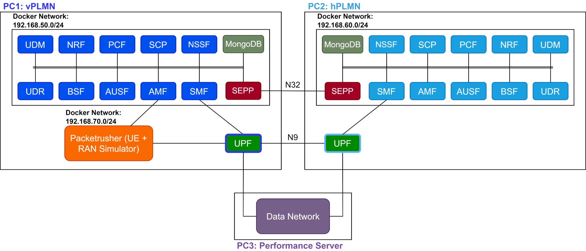
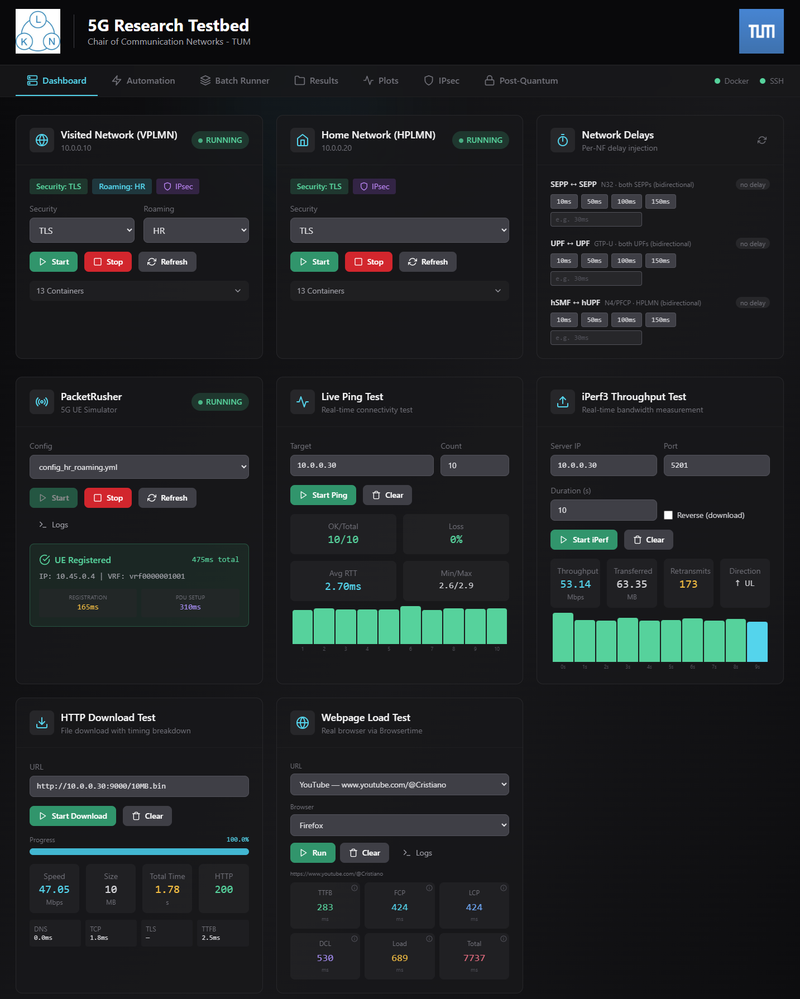

<p align="center">
  
</p>

# LKN 5G Roaming Testbed

A containerized 5G research testbed for roaming based on [Open5GS](https://open5gs.org/), supporting **Home Routed (HR)** and **Local Breakout (LBO)** roaming scenarios across two machines (physical PCs, VMs) with optional control plane TLS and user plane IPsec encryption,.

> This testbed is developed as part of the research at the Chair of Commnuication Networks at the Technical University of Munich. If you use this work, please [cite us](#citation).

---

## Table of Contents

- [Overview](#overview)
- [Architecture](#architecture)
- [Deployment Modes](#deployment-modes)
- [Network Configuration](#network-configuration)
- [Getting Started](#getting-started)
- [Repository Structure](#repository-structure)
- [Further Documentation](#further-documentation)
- [References](#references)
- [Citation](#citation)

---

## Overview

This testbed provides a complete 5G core network deployment using Open5GS with Docker containers distributed across **two machines**:

- **PC1 (VPLMN)**: Visited Public Land Mobile Network
- **PC2 (HPLMN)**: Home Public Land Mobile Network

The testbed is built on **Open5GS v2.7.6**. For LBO and Non-Roaming modes, the UPF uses Open5GS v2.7.2.

### Key Features

| Feature | Description |
|---------|-------------|
| **Home Routed (HR) Roaming** | Traffic is routed back to the home network via N9 interface |
| **Local Breakout (LBO) Roaming** | Traffic breaks out at the visited network |
| **Non-Roaming Mode** | Single network operation without roaming |
| **TLS/Non-TLS Modes** | Configurable security for NF communications |
| **Live Binary Updates** | Modify source code and test without rebuilding Docker images |
| **PacketRusher Integration** | Built-in UE/gNB simulation for all roaming modes |
| **Automated Batch Testing** | Scripts for running experiments across all configurations with delay emulation |
| **Real-Browser Web Performance** | Browsertime-based webpage tests capturing TTFB, FCP, LCP, DOMContentLoaded, and Page Load through the GTP tunnel |

---

## Architecture

<p align="center">
  
</p>

### Network Functions Deployed

Each network (VPLMN and HPLMN) deploys the following containerized 5G Core Network Functions:

| Network Function | Description |
|------------------|-------------|
| **AMF** | Access and Mobility Management Function |
| **SMF** | Session Management Function |
| **UPF** | User Plane Function (runs in host network mode) |
| **NRF** | Network Repository Function |
| **SCP** | Service Communication Proxy |
| **AUSF** | Authentication Server Function |
| **UDM** | Unified Data Management |
| **UDR** | Unified Data Repository |
| **PCF** | Policy Control Function |
| **NSSF** | Network Slice Selection Function |
| **BSF** | Binding Support Function |
| **SEPP** | Security Edge Protection Proxy (inter-PLMN) |
| **MongoDB** | Subscriber database |

All NFs run in Docker containers on dedicated bridge networks, except the UPF which uses **host network mode** to handle GTP-U tunneling and data plane traffic directly on the host.

---

## Deployment Modes

The VPLMN side supports three operating modes, each configurable with TLS or non-TLS security via `VPLMN/lib/features/set-open5gs-mode.sh`. The HPLMN side uses `HPLMN/lib/features/set-open5gs-mode.sh` to select the matching NF-to-NF security mode.

| Mode | Description | Inter-PLMN Interfaces |
|------|-------------|-----------------------|
| **Home Routed (HR)** | User traffic is routed back to the home network | N32 + N9  |
| **Local Breakout (LBO)** | User traffic breaks out locally at the visited network | N32 |
| **Non-Roaming** | Single-network standalone operation | None |

Combining the three roaming modes with TLS/non-TLS security yields **6 testable configurations**.

UE and gNB simulation is handled by [PacketRusher](https://github.com/HewlettPackard/PacketRusher), running on the VPLMN PC with per-mode configuration files.

---

## Network Configuration

### Docker Networks

| Network | Subnet | Purpose |
|---------|--------|---------|
| my_custom_network (VPLMN) | 192.168.50.0/24 | Core NF communication |
| my_custom_network (HPLMN) | 192.168.60.0/24 | Core NF communication |
| my_second_network | 192.168.70.0/24 | N2/N3 interfaces (gNB - AMF/UPF) |
| my_isolated_network | 192.168.80.0/24 | UPF2 (if second UPF is deployed on VPLMN) |

### IP Address Mapping — VPLMN (192.168.50.0/24)

| Network Function | IP Address | FQDN |
|------------------|------------|------|
| MongoDB | 192.168.50.198 | — |
| NRF | 192.168.50.189 | nrf.5gc.mnc071.mcc999.3gppnetwork.org |
| SCP | 192.168.50.188 | scp.localdomain |
| AMF | 192.168.50.185 | amf.localdomain |
| SMF | 192.168.50.193 | smf.5gc.mnc071.mcc999.3gppnetwork.org |
| UPF | Host Network | upf.localdomain |
| AUSF | 192.168.50.191 | ausf.5gc.mnc071.mcc999.3gppnetwork.org |
| UDM | 192.168.50.192 | udm.5gc.mnc071.mcc999.3gppnetwork.org |
| PCF | 192.168.50.194 | pcf.localdomain |
| NSSF | 192.168.50.195 | nssf.5gc.mnc071.mcc999.3gppnetwork.org |
| BSF | 192.168.50.196 | bsf.5gc.mnc071.mcc999.3gppnetwork.org |
| UDR | 192.168.50.199 | udr.localdomain |
| SEPP | 192.168.50.251 | sepp.localdomain |

### IP Address Mapping — HPLMN (192.168.60.0/24)

| Network Function | IP Address | FQDN |
|------------------|------------|------|
| MongoDB | 192.168.60.198 | — |
| NRF | 192.168.60.189 | nrf.5gc.mnc001.mcc001.3gppnetwork.org |
| SCP | 192.168.60.188 | scp.localdomain |
| AMF | 192.168.60.185 | amf.localdomain |
| SMF | 192.168.60.193 | smf.5gc.mnc001.mcc001.3gppnetwork.org |
| UPF | Host Network | upf.localdomain |
| AUSF | 192.168.60.191 | ausf.5gc.mnc001.mcc001.3gppnetwork.org |
| UDM | 192.168.60.192 | udm.5gc.mnc001.mcc001.3gppnetwork.org |
| PCF | 192.168.60.194 | pcf.localdomain |
| NSSF | 192.168.60.195 | nssf.5gc.mnc001.mcc001.3gppnetwork.org |
| BSF | 192.168.60.196 | bsf.5gc.mnc001.mcc001.3gppnetwork.org |
| UDR | 192.168.60.199 | udr.localdomain |
| SEPP | 192.168.60.251 | sepp.localdomain |

### Exposed Ports

| Port | Protocol | Service | Description |
|------|----------|---------|-------------|
| 38412 | UDP | AMF | N2 interface (NGAP) |
| 8080 | TCP | SEPP | N32-c interface |
| 8081 | TCP | SEPP | N32-f interface |

---

## Getting Started

### Prerequisites

- 2 PCs running Ubuntu 20.04/22.04 LTS with network connectivity between them
- Docker and Docker Compose (v2) installed on both PCs
- Open5GS v2.7.6 built from source on both PCs
- PacketRusher with the gtp5g kernel module on PC1 (VPLMN only)

### Installation & Setup

For step-by-step installation instructions, see the setup guide for each PLMN:

- **[VPLMN Setup Guide (PC1)](VPLMN/README.md)** — Full installation, IP configuration, PacketRusher setup, and troubleshooting
- **[HPLMN Setup Guide (PC2)](HPLMN/README.md)** — Installation and configuration for the home network

> **Setup order:** run `HPLMN/setup.sh` on PC2 before `VPLMN/setup.sh` on PC1. VPLMN's setup ends with an optional N9 IPsec tunnel step ([docs/IPSEC.md](docs/IPSEC.md)) that drives both PCs over SSH and requires HPLMN already set up and reachable — starting with HPLMN lets that step complete in one pass instead of failing and needing a manual re-run later.

---

## Repository Structure

```
.
├── README.md                        # This file (project overview)
├── VPLMN/      # Visited PLMN — setup guide, NFs, automation scripts
│   ├── README.md
│   ├── docker-compose.yml
│   ├── docker/                      # Per-NF Dockerfiles, YAML configs, certs, binaries
│   │   ├── <nf>-docker/
│   │   └── pq-ike-docker/           # Local post-quantum IKEv2 sub-testbed
│   ├── testbed_automation.sh
│   ├── batch_runner.sh
│   ├── configs/
│   └── ...
├── HPLMN/      # Home PLMN — setup guide and NFs
│   ├── README.md
│   ├── docker-compose.yml
│   ├── docker/
│   │   └── <nf>-docker/
│   └── ...
├── docs/
│   ├── figures/
│   ├── AUTOMATION.md
│   ├── BATCH_RUNNER.md
│   └── IPSEC.md
└── README.md
```

---
## Optional Web UI

<p align="center">
  
</p>


---
## Further Documentation

| Document | Description |
|----------|-------------|
| [VPLMN Setup Guide](VPLMN/README.md) | Installation, configuration, and troubleshooting for the visited network |
| [HPLMN Setup Guide](HPLMN/README.md) | Installation and configuration for the home network |
| [Automation Script](docs/AUTOMATION.md) | Testbed automation script usage, config file format, and delay modes |
| [Batch Runner](docs/BATCH_RUNNER.md) | Running batch experiments across multiple configurations |
| [IPsec Tunnel](docs/IPSEC.md) | Establishment of the IPsec tunnel for the N9 interface during HR roaming |
| [Web UI](VPLMN/webui/README.md) | Browser-based Web UI for managing, monitoring, and automating the testbed |

---

## References

- [Open5GS Documentation](https://open5gs.org/open5gs/docs/)
- [Open5GS GitHub Repository](https://github.com/open5gs/open5gs)
- [PacketRusher GitHub Repository](https://github.com/HewlettPackard/PacketRusher)

---

## Citation

If you use this testbed in your research, please cite the project repository.

Parts of this testbed were first presented as a demo at ACM WiSec '26:
```
@inproceedings{zeidler_demo_2026,
	address = {New York, NY, USA},
	series = {{WiSec} '26},
	title = {{DEMO: 5G SA Roaming Testbed for Post Quantum IPsec Security Evaluations}},
	url = {https://dl.acm.org/doi/10.1145/3765613.3814568},
	doi = {10.1145/3765613.3814568},
	booktitle = {Proceedings of the 19th ACM Conference on Security and Privacy in Wireless and Mobile Networks},
	publisher = {Association for Computing Machinery},
	author = {Zeidler, Oliver and Günes, Mert and Anirudh M., Sai and Kellerer, Wolfgang},
	month = june,
	year = {2026},
}
```

---

## Affiliation

This project is developed at the **[Chair of Communication Networks](https://www.ce.cit.tum.de/en/lkn/home/)**, **Technical University of Munich (TUM)**.
